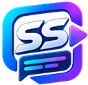

<div align="center">
  
  <h1>SubShift AI</h1>
  <p><strong>Yapay Zeka Destekli Altyazı Çeviri Stüdyosu</strong></p>
  <p>Google Gemini AI modelleriyle zaman kodlarını koruyarak çalışan profesyonel altyazı çeviri stüdyosu.</p>

  [](LICENSE)
  [](https://dotnet.microsoft.com/)
  []()
</div>

---

## ✨ Özellikler

- ⏱️ **Zaman Kodu Koruma:** `.srt` zaman kodları ve HTML etiketleri (`<i>`, `<b>`, `[efekt]`) bozulmadan çevrilir.
- 🔑 **Çoklu API Anahtarı Desteği:** Birden fazla Gemini API anahtarı ekleyin; kota (rate limit) aşıldığında otomatik failover/rotasyon uygulanır.
- ⚡ **Grup Halinde Çeviri (Batching):** Replikler grup halinde işlenerek token verimliliği ve hız maksimize edilir.
- 🎨 **Modern Windows 11 Arayüzü:** VS Code tarzı başlık çubuğu, donanım ivmeli yuvarlatılmış köşeler ve senkron çift taraflı önizleme.
- 🌐 **Çoklu Dil Desteği:** `locale/` dizinindeki JSON dosyaları üzerinden kolayca yeni diller eklenebilir.

---

## 🚀 Başlarken

### Gereksinimler
- Windows 10 (1809+) veya Windows 11
- [.NET Desktop Runtime (x64)](https://dotnet.microsoft.com/download)

### Kurulum ve Derleme
```bash
# Depoyu klonlayın
git clone [https://github.com/mebkitguru/subshift.git](https://github.com/mebkitguru/subshift.git)
cd subshift

# Bağımlılıkları geri yükleyin ve derleyin
dotnet build -c Release

# Tek dosya çalıştırılabilir .exe üretimi
dotnet publish -c Release -r win-x64 --self-contained false /p:PublishSingleFile=true
